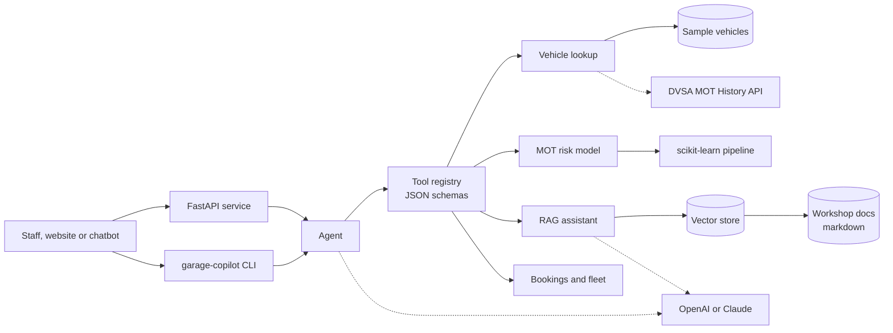

# Garage Copilot

[](https://github.com/FASEEHSYED786/garage-copilot/actions/workflows/ci.yml)


An AI copilot for garages, car audio fitters and courtesy-car fleets. It looks up a vehicle by registration, predicts whether it will fail its next MOT, answers policy questions from the workshop's own documents with citations, and books jobs through a tool-using agent.

```text
$ garage-copilot agent "Is RS14 ABC likely to fail its MOT?"
RS14 ABC is a 2014 Nissan Qashqai on 128,618 miles, MOT due 10 Apr 2027.
MOT failure risk is high at 77% (3 advisories on the last MOT, 5 previous MOT failure(s), 12 years old, high mileage (128,618 miles)).
I'd recommend our 20-minute pre-MOT check.
We offer a 20-minute pre-MOT check for cars at high risk of failure. [1] ...
Sources: MOT and servicing guide > Pre-MOT check

(tools used: lookup_vehicle, mot_risk, search_knowledge)
```

## Why I built this

I build booking, vehicle lookup and lead capture systems for automotive businesses in Cambridge. The same questions come up every day at the front desk: when is this car's MOT due, is it likely to fail, is there a courtesy car free, will this head unit work with the factory amp. This project packages the answers into one Python service with a clean API, so a website, a chatbot or a member of staff can all use the same logic.

It is a personal project. All vehicles, policies and data in the repo are made up for demonstration. No client code or customer data is included.

## What it does

| Capability | How it works |
| --- | --- |
| **Vehicle lookup** | `VehicleLookup` interface with a mock adapter (sample data) and a DVSA MOT History API adapter |
| **RAG over workshop knowledge** | Heading-aware markdown chunking, TF-IDF or OpenAI embeddings, an in-memory vector store, query expansion for customer wording, and answers with numbered citations |
| **MOT failure risk** | scikit-learn pipeline (one-hot + gradient boosting) trained on synthetic MOT outcomes, with plain-English reasons a service adviser can repeat |
| **Bookings and courtesy cars** | Workshop capacity, weekday rules and the "jobs over four hours get a courtesy car" policy |
| **Agent** | One tool registry with JSON schemas, used by a deterministic rule-based planner (offline) or by an LLM through OpenAI function calling |
| **API and CLI** | FastAPI service with typed request and response models, plus a `garage-copilot` command |

## Architecture



Dashed lines are optional. With no keys set, everything runs offline: TF-IDF embeddings, extractive answers and the rule-based planner. That keeps the tests deterministic and lets anyone clone and run it in a minute.

## Quick start

```bash
git clone https://github.com/FASEEHSYED786/garage-copilot
cd garage-copilot
python -m venv .venv && source .venv/bin/activate
pip install -e ".[dev]"

garage-copilot train                      # train and save the MOT risk model
garage-copilot ask "What is the excess on the courtesy car?"
garage-copilot agent "Book GH15 MNP in for a service on Friday with a courtesy car"
garage-copilot eval                       # retrieval quality report
garage-copilot serve                      # API docs at http://127.0.0.1:8000/docs
```

Or with Docker:

```bash
docker build -t garage-copilot .
docker run -p 8000:8000 garage-copilot
```

### Switching on real providers

Copy `.env.example` to `.env` and set what you need:

```bash
GARAGE_LLM_PROVIDER=openai        # or anthropic
OPENAI_API_KEY=...
GARAGE_VEHICLE_SOURCE=dvsa
DVSA_API_KEY=...
DVSA_ACCESS_TOKEN=...
```

With `openai` the agent switches to LLM tool calling, and RAG answers are written by the model from the retrieved passages only.

## API

| Method | Path | Purpose |
| --- | --- | --- |
| GET | `/health` | Status, provider, number of indexed chunks, model AUC |
| GET | `/vehicles/{registration}` | Vehicle details and MOT history |
| GET | `/vehicles/{registration}/mot-risk` | Failure probability, band and reasons |
| POST | `/ask` | `{"question": "..."}` → answer and citations |
| GET | `/fleet/availability?day=YYYY-MM-DD` | Free courtesy cars |
| POST | `/agent` | `{"message": "..."}` → reply and the tools the agent used |

## Quality

- **51 tests** with pytest covering lookup, chunking, retrieval, the model, the agent, the API and the CLI. HTTP calls to DVSA, OpenAI and Anthropic are tested with `httpx.MockTransport`, so no network or keys are needed.
- **Retrieval is measured, not eyeballed.** `garage-copilot eval` runs 18 labelled questions and reports hit@1, hit@3 and MRR. Current results: hit@1 0.94, hit@3 1.00, MRR 0.97. A test fails the build if retrieval quality drops.
- **Model check.** The risk model reaches a ROC AUC of about 0.81 on held-out synthetic data, with a fail rate of about 30%, close to the real UK first-attempt figure. A test also checks that older, high-mileage cars with advisories score higher than new ones.
- **CI** on GitHub Actions: ruff lint and format checks, tests on Python 3.11 and 3.12, the retrieval eval, then a Docker build with a smoke test against the running container.

## Project layout

```text
src/garage_copilot/
  vehicles/   models, registration parsing, mock and DVSA adapters
  rag/        chunking, embeddings, vector store, assistant, evaluation
  ml/         synthetic dataset, features, risk model
  agent/      tool registry, rule-based and OpenAI tool-calling agents
  fleet.py    bookings and courtesy cars
  llm.py      OpenAI and Anthropic clients over plain HTTP
  core.py     wiring: picks adapters from settings
  api.py      FastAPI app
  cli.py      command line
  data/       sample vehicles, workshop docs, eval questions
tests/
```

## Design decisions

- **Interfaces first.** The agent depends on a `VehicleLookup` protocol and a tool registry, not on concrete services. Swapping mock data for the DVSA API, or TF-IDF for OpenAI embeddings, is a settings change.
- **Offline by default.** A product that only works with an API key is hard to test and demo. Every AI feature has a deterministic fallback.
- **Grounded answers.** The LLM prompt only allows answers from numbered passages, and every answer returns its sources. Out-of-scope questions return "I couldn't find that" instead of a guess.
- **Explainable predictions.** A risk score comes with reasons in plain English, because a service adviser has to explain it to a customer.

## Roadmap

- Train the risk model on the DVSA anonymised MOT dataset instead of synthetic data
- Swap TF-IDF for dense embeddings with a cross-encoder reranker and compare on the eval set
- Persist bookings in Postgres and the vector index in pgvector
- Anthropic tool use for the agent, alongside OpenAI

## Licence

MIT
